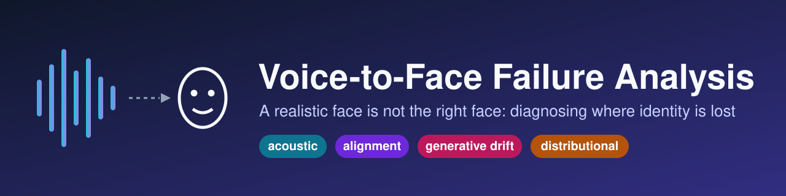
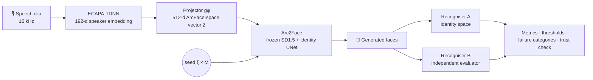

<div align="center">



[](pyproject.toml)
[](LICENSE)
[](tests/)
[](#-status)
[](https://www.amrita.edu/)

**Why do diffusion-based voice-to-face models produce a realistic face that is the *wrong* person?**
This toolkit finds out *where* in the pipeline the identity is lost.

[Pipeline](#-pipeline) · [Failure taxonomy](#-failure-taxonomy) · [Quick start](#-quick-start) · [Dataset](#-dataset-a-voxceleb2-subset-under-3-gb) · [Status](#-status) · [Ethics](#-ethics)

</div>

---

## ✨ The idea

Voice-to-face generators are usually judged on how real the face *looks*. But a speaker's voice cannot uniquely determine their face, so a photorealistic output can still be a confident mistake. This project is **not another generator**. It wraps a frozen, identity-conditioned diffusion model ([Arc2Face](https://github.com/foivospar/Arc2Face)) in a measurement layer and answers one question for every failed sample:

> *Was the identity lost in the **speech embedding**, in the **speech→face alignment**, in the **diffusion sampling**, or because the model is **systematically worse for some groups**?*

By the data processing inequality, identity information can only shrink along `speaker → speech → embedding → identity vector → face`. A realistic image cannot repair a lossy vector, only hide the loss. So we measure each stage separately.

## 🔬 Pipeline



| Stage | Script | Produces (in `work/`) |
| :-: | --- | --- |
| 0 | `scripts/00_fetch_vox2_subset.py` | `data/vox2_subset/` mp4 clips + `manifest.csv` (no full download) |
| 1 | `scripts/01_make_subset.py` | `pairs.csv`, face frames, 16 kHz wavs |
| 2 | `scripts/02_extract_features.py` | `samples.csv`, `features.npz` |
| 3 | `scripts/03_train_projector.py` | `projector.pt`, `projected.npz` |
| 4 | `scripts/04_generate_and_embed.py` | `gen_A.npy`, `gen_B.npy`, `faces/` |
| 5 | `scripts/05_analyze.py` | `results_A/`, `results_B/` |
| 6 | `scripts/06_demo_app.py` | Gradio demo with live diagnostics |

## 🧭 Failure taxonomy

Each failed sample is tested **in pipeline order** and assigned to the first stage that is unusual compared with *verified* validation samples.

| Failure | Meaning | Signal |
| --- | --- | --- |
| 🟦 **Acoustic** | Speaker embedding is unstable under noise, clipping, telephone band | acoustic sensitivity `A` |
| 🟪 **Alignment** | Stable embedding is mapped to the wrong identity vector | alignment error `E_align` |
| 🟥 **Generative drift** | Good vector, but different seeds give different people | identity drift |
| 🟧 **Distributional** | Pipeline is consistent but worse for a group (age, sex, language, recording) | subgroup disparity `D` + bootstrap CI |
| ⬜ **Unattributed** | Meets none or several conditions equally | sent to manual review |

Also included: Recall@1/5/10 with chance level, acceptance rate at a fixed FAR set on validation impostors, speaker-level bootstrap CIs, Holm-corrected subgroup tests, and a label-free **trust check** that refuses outputs when stability or drift is out of range.

## 🚀 Quick start

```bash
# 0) sanity-check the analysis code (CPU, no data)
pip install -e ".[dev]" && pytest -q
python -m vf.analysis --demo        # synthetic smoke test; its numbers mean nothing

# 1) get a small VoxCeleb2 subset (see next section)
pip install remotezip tqdm
python scripts/00_fetch_vox2_subset.py --dry-run
python scripts/00_fetch_vox2_subset.py --out data/vox2_subset --max-gb 2.5

# 2) run the GPU stages (e.g. Colab T4)
pip install -r requirements-gpu.txt && pip install -e .
git clone https://github.com/foivospar/Arc2Face
bash run_all.sh
```

Read the output in `work/results_A/results_tables.txt` (identity and retrieval, failure profile, diagnostics, subgroup disparity, thresholds, trust check). `results_B` repeats identity and retrieval with the independent recogniser.

## 📦 Dataset: a VoxCeleb2 subset under 3 GB

The official VoxCeleb2 dev set is hundreds of GB, and even the *test* archive is ~8.9 GB. Instead of downloading it, `00_fetch_vox2_subset.py` reads the zip index over HTTP range requests and extracts only the clips it needs.

| Option | Speakers | Size | Notes |
| --- | :-: | :-: | --- |
| `--speakers 118 --videos-per-speaker 12` (default) | 118 | well under 1 GB | Vox2 **test** speakers are disjoint from the dev data ECAPA was trained on |
| larger `--videos-per-speaker` | 118 | up to the `--max-gb` cap | more clips per speaker, still only 118 identities |

Keep splits **speaker-disjoint**, and aim for at least 5 speakers per subgroup or the subgroup test reports "not analysable". Respect the VoxCeleb licence (research use); see [`docs/ETHICS_AND_LICENSES.md`](docs/ETHICS_AND_LICENSES.md).

## 🗂️ Layout

```
src/vf/        analysis · audio · speech · faces · projector · generator
scripts/       00 … 06, one per stage
tests/         CPU smoke tests on synthetic data
docs/          PROTOCOL · TROUBLESHOOTING · ETHICS_AND_LICENSES
assets/        banner and figures
run_all.sh     end-to-end pilot
```

## 🚦 Status

- [x] Analysis code (`src/vf/analysis.py`), unit-tested on synthetic data
- [x] Subset fetcher (`00_fetch_vox2_subset.py`)
- [ ] GPU stages 2, 3, 4, 6 run end to end *(written against library docs, not yet executed)*
- [ ] Integrated Gradients and SHAP attributions, attention maps
- [ ] Counterfactual pitch/rate edits, LPIPS diversity, FID or face-quality score

**No results are included in this repository.** Do not report numbers this code has not produced.

## 📝 Citation

```bibtex
@misc{gopal2026voice2face,
  title  = {Failure Analysis of Diffusion-Based Voice-to-Face Generation: An Explainable AI Perspective},
  author = {Gopal, Arjun and Ramnath and Sidharth, P V and Kumar, T Senthil},
  year   = {2026},
  note   = {Manuscript in preparation. Amrita School of Computing, Coimbatore}
}
```

## ⚖️ Ethics

A face generated from a voice is **not evidence of who a speaker is**. This project measures and warns about that unreliability; it must not be used for identification. Details in [`docs/ETHICS_AND_LICENSES.md`](docs/ETHICS_AND_LICENSES.md).

## 🙏 Acknowledgements

[Arc2Face](https://github.com/foivospar/Arc2Face) · [InsightFace / ArcFace](https://github.com/deepinsight/insightface) · [SpeechBrain](https://speechbrain.github.io/) · [VoxCeleb](https://www.robots.ox.ac.uk/~vgg/data/voxceleb/)
